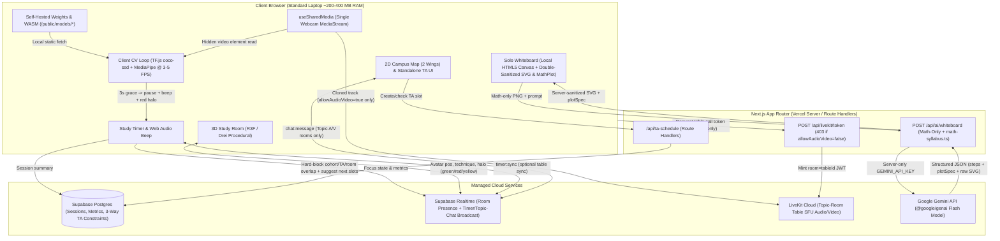
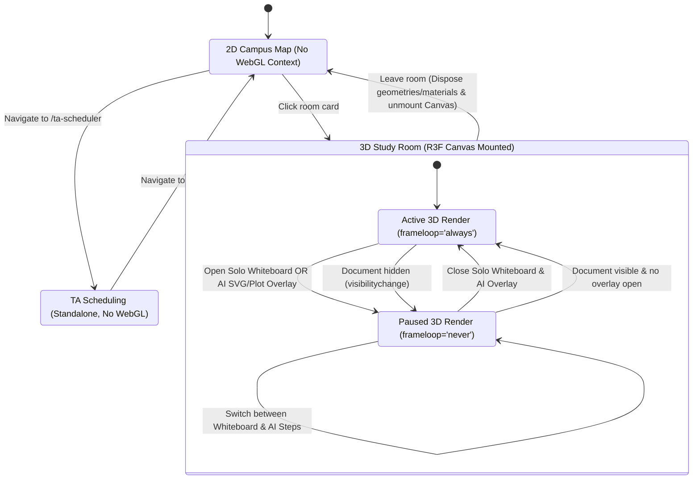
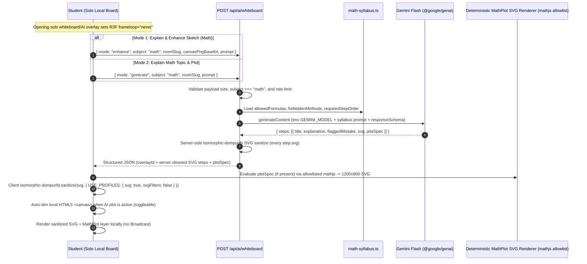

# EdMonitor — System & Runtime Architecture

Focused runtime specifications for the four boundaries where state, media locks, GPU contention, and untrusted payloads actually fail.

---

## 1. System Context & Trust Boundaries

Separates browser-only workloads (WebGL, WASM/WebGL CV, shared `MediaStream`, solo whiteboard canvas + deterministic MathPlot SVG renderer) from server-only secrets (`GEMINI_API_KEY`, `LIVEKIT_API_SECRET`, `SUPABASE_SERVICE_ROLE_KEY`) and realtime channels.



### Critical Boundary Invariants
- **Zero webcam frames leave the browser for CV**: `CV` reads frames locally from `useSharedMedia`; only LiveKit media tracks (in `allowAudioVideo: true` rooms) go to `LKCloud`, and only solo whiteboard canvas PNG snapshots go to `AIRoute`.
- **Two-Wing Room Policy (`allowAudioVideo`)**:
  - **General Study (Silent)** (`allowAudioVideo: false`): LiveKit and table chat UI are hidden, `baseVideoTrack.clone()` is never called, and `POST /api/livekit/token` rejects requests with `403 FORBIDDEN`. Local webcam CV Focus Guard, timers, and the solo whiteboard still run normally.
  - **Math (Topic A/V)** (`allowAudioVideo: true`): Full table LiveKit A/V (`track.clone()`) and plain-text `chat:message` enabled alongside CV Focus Guard, timers, and the solo whiteboard.
- **Table-scoped vs. Room-scoped channels**:
  - `room:{roomSlug}` Presence channel carries lightweight avatar coordinates, active study technique, and halo state (`green` | `red` | `yellow`).
  - `table:{roomSlug}:{tableId}` Broadcast channel carries **only** `timer:sync` and (in Topic A/V rooms) plain-text `chat:message`.
  - **Solo Whiteboard Isolation**: Whiteboard strokes, undo/clear, and AI/MathPlot overlays live strictly in local student state—never broadcast over Supabase Realtime.
- **Standalone TA Scheduling**: `src/app/ta-scheduler/page.tsx` routes for TA scheduling never mount `R3F`, `Media`, or `CV`.

---

## 2. Shared Media & Client-Side CV Sequence

Prevents the two classic webcam bugs:
1. **OS camera hardware lock** (`NotReadableError`) from LiveKit and CV calling `getUserMedia` separately.
2. **Track lifecycle teardown** where leaving a table call calls `track.stop()` and accidentally kills CV focus tracking (or leaving a room forgets to stop tracks, keeping the camera LED on).

```mermaid
sequenceDiagram
  autonumber
  participant User as Student
  participant Hook as useSharedMedia
  participant Cam as Browser MediaDevices
  participant LK as LiveKit Table Call (Topic A/V Only)
  participant CV as CV Loop (3-5 FPS)
  participant Grace as 3s Grace State Machine
  participant FX as Timer + Audio + Presence

  User->>Hook: Enter room / enable focus tracking
  Hook->>Cam: getUserMedia({ video: true, audio: false }) (Once)
  Cam-->>Hook: Base MediaStream (refCount = 1)
  Hook-->>CV: Attach Base MediaStream to hidden video element

  alt Room has allowAudioVideo === true (Math Topic Room)
    User->>Hook: Sit at Study Table (join call)
    Hook->>Hook: baseVideoTrack.clone() for LiveKit isolation
    Hook-->>LK: Provide cloned video track (stopping clone won't kill CV)
  else Room has allowAudioVideo === false (General Study Silent Room)
    Note over Hook,LK: Never clone baseVideoTrack; LiveKit & table chat stay unmounted/hidden
  end

  loop Every 200-333 ms (3-5 FPS setInterval / setTimeout, never rAF)
    CV->>CV: Read video frame -> coco-ssd (cell phone) + Face Landmarker
    alt Distraction detected (phone in frame OR face absent / look-away)
      CV->>Grace: reportSample(DISTRACTED, now)
      alt Continuous distraction < 3000 ms
        Grace-->>CV: Pending (ignore transient glance, no alert)
      else Continuous distraction >= 3000 ms (and not already alerting)
        Grace->>FX: Trigger DISTRACTED transition
        FX->>FX: Play Web Audio API beep + auto-pause study timer
        FX->>FX: Log distraction event + broadcast avatar halo = "red"
      end
    else User focused (no phone AND face attentive)
      CV->>Grace: reportSample(FOCUSED, now)
      Grace->>FX: Clear distraction timer + broadcast avatar halo = "green"
    end
  end

  opt Seated in Topic A/V Room
    User->>Hook: Stand up from Table (leave call, stay in room)
    LK->>Hook: Release cloned track (clone.stop())
    Note over Hook,CV: Base MediaStream stays alive - CV loop continues uninterrupted
  end

  User->>Hook: Exit 3D Room to 2D Campus Map
  Hook->>Cam: Stop base tracks + unmount video element (webcam LED turns off)
```

### Failure Modes Guarded
- **Track cloning for LiveKit**: LiveKit SDK routinely stops tracks when disconnecting from a room. Passing `baseVideoTrack.clone()` to LiveKit (only when `allowAudioVideo === true`) isolates its lifecycle from the CV `<video>` element.
- **Silent-room media discipline**: When `allowAudioVideo === false`, LiveKit never connects and `baseVideoTrack.clone()` is never called, while CV continues uninterrupted.
- **Timer-break exemption**: When the user's study timer enters a scheduled break (`halo = "yellow"`), pause distraction alerts until the next focus block starts.

---

## 3. WebGL GPU Budget State Machine

Standard laptops cannot sustain a 60 FPS WebGL scene, WebRTC video decoding, HTML5 canvas drawing, and TF.js/MediaPipe inference simultaneously without thermal throttling or dropped frames.

Instead of unmounting `<Canvas>` (which destroys the WebGL context, leaks/recompiles shaders, and resets camera state), toggle R3F's `frameloop` prop.



### Implementation Contract
- Derive a single boolean: `const is3DPaused = isWhiteboardOpen || isAIOverlayOpen || isTabHidden;`
- Bind directly to R3F: `<Canvas frameloop={is3DPaused ? "never" : "always"}>`.
- While `PausedRender` is active, Supabase Presence updates still mutate React/ref state in memory so avatars snap to their latest positions on the very first frame after closing the overlay.

---

## 4. Solo AI Whiteboard Enhancement, MathPlot & Double SVG Sanitization

Covers both **Math-only** modes (**Explain & Enhance Sketch** via PNG snapshot and **Explain Math Topic & Plot** via prompt), aligns the student's solo HTML5 `<canvas>` and `<svg viewBox="0 0 1200 800">` onto a single `1200 × 800` virtual coordinate space, renders deterministic `MathPlotSpec` Cartesian plots using an allowlisted `mathjs` evaluator, and enforces double SVG sanitization with `isomorphic-dompurify`.



### Double-Sanitization & Deterministic Plot Rules
1. **Server Route (`POST /api/ai/whiteboard`)**: Runs `isomorphic-dompurify` (`USE_PROFILES: { svg: true, svgFilters: false }`, forbidding `<script>`, `<foreignObject>`, `<iframe>`, `<object>`, `<embed>`, `<style>`, `on*`, and `javascript:`/external `href`) immediately so raw Gemini output never leaves our API boundary unsanitized.
2. **Client Renderer (`SvgOverlayLayer.tsx`)**: Runs `isomorphic-dompurify` again on all SVG markup before DOM injection as defense-in-depth.
3. **Deterministic `MathPlotSpec` Evaluation**: Analytical curves (`y = f(x)` and `x = g(y)`), asymptote/domain breaks, `shadedRegions[]` for crossing curves, `dx`/`dy` representative slices, and intersections are never hand-coded as raw SVG by the LLM when plotting functions—instead, `plotSpec` expressions are compiled through an explicit `mathjs` allowlist (no `eval`, `Function`, `import`, or arbitrary symbols) and mapped deterministically to `1200 × 800` SVG coordinates.
