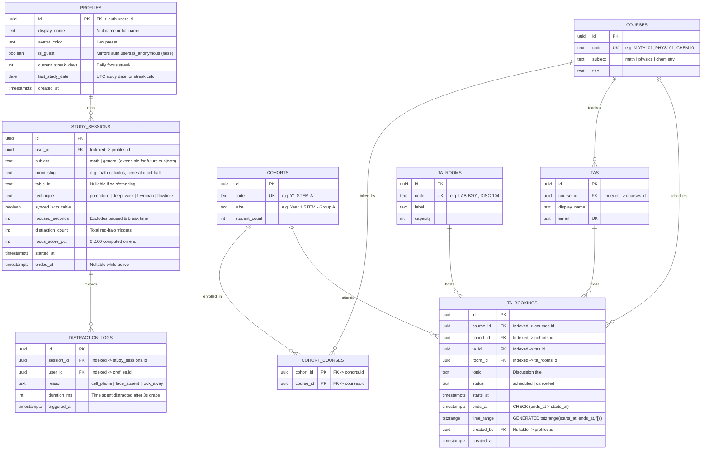
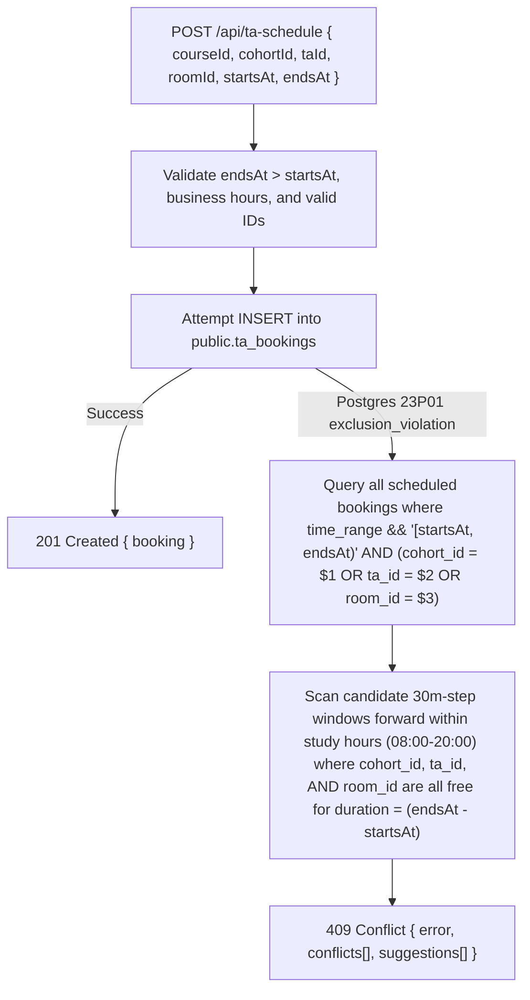

# EdMonitor — Database Schema, 3-Way Conflict Rules & Realtime Channels

Postgres data model (Supabase), database-enforced 3-way TA conflict exclusion rules, RLS boundaries, and exact Supabase Realtime channel/payload contracts.

---

## 1. Entity-Relationship Diagram (ERD)

Users join via **Supabase Verified Email Auth** (`auth.users.email_confirmed_at IS NOT NULL`, `is_anonymous = false`) backed by `public.profiles` (`id = auth.users.id`). Anonymous sign-ins are disabled and blocked by restrictive RLS policies.



### Core Postgres & RLS Rules
- **Additive `study_sessions.subject` migration (Sprint 2)**: Sprint 0's `202611260001_initial_schema.sql` remains untouched and keeps `courses.subject in ('math', 'physics', 'chemistry')` for Sprint 1 `/ta-scheduler`. Sprint 2 adds a new migration (`supabase/migrations/202611260005_study_sessions_allow_general.sql`) replacing the `study_sessions_subject_check` constraint with `check (subject in ('math', 'general', 'physics', 'chemistry'))` so General Study sessions persist cleanly while remaining extensible for future subjects.
- **Foreign key & query indexes**: Every `*_id` foreign key column is explicitly indexed (`CREATE INDEX`), plus `(user_id, started_at DESC)` on `study_sessions` for the Progress Dashboard.
- **RLS enabled on all `public` tables**:
  - `profiles`, `study_sessions`, `distraction_logs`: `TO authenticated` using `(select auth.uid()) = user_id` (and `id` on `profiles`) with matching `WITH CHECK` on `INSERT`/`UPDATE`, plus restrictive non-anonymous JWT check. Never use deprecated `auth.role()` or `user_metadata`.
  - `courses`, `cohorts`, `cohort_courses`, `tas`, `ta_rooms`, `ta_bookings`: Readable by verified authenticated non-anonymous users; writes to `ta_bookings` execute through validated server Route Handlers (`createAdminClient()`).

---

## 2. Hard-Blocked 3-Way TA Conflict Logic

### Postgres Exclusion Constraints (Atomic, Race-Free)

UI checks and `SELECT`-before-`INSERT` checks are vulnerable to concurrent double-bookings. EdMonitor enforces all three conflict dimensions atomically in Postgres using `btree_gist` (installed in `extensions` schema) and half-open `[starts_at, ends_at)` ranges (`'[)'`, so `10:00–11:00` and `11:00–12:00` back-to-back **never** collide):

```sql
create extension if not exists btree_gist with schema extensions;

alter table public.ta_bookings
  add column time_range tstzrange
  generated always as (tstzrange(starts_at, ends_at, '[)')) stored;

-- 1. Same student cohort cannot attend two discussions at once (even across subjects)
alter table public.ta_bookings
  add constraint excl_ta_booking_cohort_overlap
  exclude using gist (cohort_id with =, time_range with &&)
  where (status = 'scheduled');

-- 2. Same TA cannot teach two discussions at once
alter table public.ta_bookings
  add constraint excl_ta_booking_ta_overlap
  exclude using gist (ta_id with =, time_range with &&)
  where (status = 'scheduled');

-- 3. Same physical/virtual room cannot host two discussions at once
alter table public.ta_bookings
  add constraint excl_ta_booking_room_overlap
  exclude using gist (room_id with =, time_range with &&)
  where (status = 'scheduled');
```

### Conflict Resolution & `409 Conflict` Flow



### Conflict Dimensions & `409` Response Contract

| Dimension | Blocking Condition (`status = 'scheduled'`) | Postgres Constraint | Example Blocked Scenario |
| :--- | :--- | :--- | :--- |
| **`cohort`** | `cohort_id = $cohortId AND time_range && $reqRange` | `excl_ta_booking_cohort_overlap` | Physics TA tries to book `Y1-STEM-A` at `14:00–15:00` while Math TA already has `Y1-STEM-A` at `14:30–15:30`. |
| **`ta`** | `ta_id = $taId AND time_range && $reqRange` | `excl_ta_booking_ta_overlap` | Same TA tries to schedule Group B overlapping their Group A session. |
| **`room`** | `room_id = $roomId AND time_range && $reqRange` | `excl_ta_booking_room_overlap` | Chemistry TA books `DISC-104` while Physics TA already occupies `DISC-104`. |

```ts
// HTTP 409 Conflict response body
export interface TaBookingConflictResponse {
  error: "BOOKING_CONFLICT";
  message: string;
  conflicts: Array<{
    dimension: "cohort" | "ta" | "room";
    bookingId: string;
    courseCode: string;
    topic: string;
    startsAt: string; // ISO-8601 UTC
    endsAt: string;   // ISO-8601 UTC
  }>;
  suggestions: Array<{
    startsAt: string; // Next conflict-free slot matching requested duration
    endsAt: string;
    roomId: string;   // Same room first; alternate free room if only room conflicted
    roomCode: string;
  }>; // Up to 3 earliest conflict-free slots
}
```

---

## 3. Supabase Realtime Channel Map

Separates **low-frequency room-wide Presence** from **table-scoped Timer & Topic-Room Chat Broadcast**.

> **Solo Whiteboard Rule:** The HTML5 `<canvas>` whiteboard, AI SVG overlay, and deterministic `MathPlotSpec` overlays are **strictly student-only (local browser state)**. There are **zero** `whiteboard:*` Broadcast events and **zero** late-joiner whiteboard snapshot syncs.

### Channel Summary

| Scope | Channel Name Pattern | Mechanism | Joined When | Left When |
| :--- | :--- | :--- | :--- | :--- |
| **2D Campus Counts** | `campus:lobby` | **Presence** | Viewing 2D Campus Map or inside any 3D room | Closing app / navigating to `/ta-scheduler` |
| **3D Room Avatars** | `room:{roomSlug}` | **Presence** (`key: userId`) | Entering a 3D room (e.g. `room:math-calculus`, `room:general-quiet-hall`) | Returning to 2D Campus Map |
| **Table Timer & Topic Chat** | `table:{roomSlug}:{tableId}` | **Broadcast** (`self: false`, `ack: false`) | Sitting at a table (matches LiveKit room name `${roomSlug}:${tableId}` in Topic A/V rooms) | Standing up from table or leaving room |

### A. Presence Payloads (`room:{roomSlug}`)

Updated only on discrete state transitions (table sit/stand, study timer mode/phase change, halo `green`/`red`/`yellow` change) or throttled waypoint moves (≤ 4 Hz)—never per render frame.

```ts
export type FocusHalo = "green" | "red" | "yellow";
export type StudyTechnique = "pomodoro" | "deep_work" | "feynman" | "flowtime";

export interface RoomPresenceState {
  userId: string;
  displayName: string;
  isGuest: boolean;
  avatarColor: string;
  tableId: string | null;          // null when walking / standing
  seatIndex: number | null;        // 0..3 seat slot around table
  position: [number, number, number];
  rotationY: number;
  technique: StudyTechnique;
  timerPhase: "focus" | "break" | "paused" | "idle";
  syncedWithTable: boolean;
  halo: FocusHalo;                 // green = focused, red = distracted, yellow = break
  updatedAt: string;
}
```

### B. Broadcast Events & Payloads (`table:{roomSlug}:{tableId}`)

All events use Supabase Realtime Broadcast (`channel.send({ type: "broadcast", event, payload })`).

| Event Name | Room Scope | Trigger Rate | Payload Shape | Receiver Rules |
| :--- | :--- | :--- | :--- | :--- |
| `chat:message` | **Topic A/V rooms only** (`allowAudioVideo === true`) | On send | `{ id: string; authorId: string; displayName: string; avatarColor: string; text: string; sentAt: string }` | Render strictly as plain text (never HTML); cap `text` ≤ 1000 chars. Ignored/unsubscribed in General Study silent rooms. |
| `timer:sync` | All study rooms | On start / pause / phase transition | `{ hostId: string; technique: StudyTechnique; phase: "focus" \| "break" \| "paused"; phaseEndsAt: string \| null; remainingMs: number }` | Applied **only** if local user has `"Sync timer with table"` enabled. |
