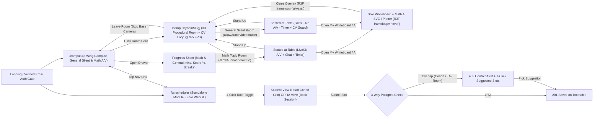

# EdMonitor — UI/UX Screens, Flows, Wireframes & Visual Spec

Concrete layout geometry, HUD anchoring, ASCII wireframes, color tokens, and state specifications so implementation never guesses spacing, z-index, or visual hierarchy.

---

## 1. Design Direction & Layout Principles

Grounded in [LEARNER_PERSONA.md](../../LEARNER_PERSONA.md) (Youssef: 20-year-old STEM undergrad who gets derailed by clutter, silent distractions, and blurry sketches):

- **Aesthetic Point of View — STEM Drafting Table**: Clean architectural surfaces (`#F8FAFC` daylight drafting slate on 2D views; `#0F172A` calm low-glare studio chrome floating over 3D rooms; `#FFFFFF` dot-grid sheet on the solo whiteboard). Avoids generic SaaS gradient cards and neon gaming HUDs.
- **Strict Color Separation**: Active campus zones use cool architectural inks (**General Study (Silent)**: Slate `#475569`; **Math (Topic A/V)**: Cobalt `#2563EB`)—while Teal (`#0D9488`) and Iris (`#7C3AED`) remain used in `/ta-scheduler` courses (`PHYS101`, `CHEM101`) and reserved for future campus wings—so **`green`**, **`red`**, and **`yellow`** remain 100% reserved for **Focus Halos & Timer States**.
- **Typography**:
  - **UI & Explanations**: `Plus Jakarta Sans` (sentence case everywhere; never tracked-out ALL-CAPS eyebrow labels; body line width ≤ 72ch).
  - **Timers, Counts & Coordinates**: `JetBrains Mono` with `font-variant-numeric: tabular-nums` so countdown ticks never jitter horizontally.

---

## 2. End-to-End User Flow



---

## 3. Core Screen Wireframes & Exact Spacing

### Screen 1: 2D Campus Map (`/campus`)

- **Viewport structure**: Sticky top bar (`h-14`, `px-6`, border-bottom) + centered container (`max-w-7xl mx-auto px-6 py-8`) keeping the entire campus comfortably visible in a single desktop viewport (**zero pan/zoom JS libraries**).
- **Architectural Blueprint Map Hybrid**: Subtle CSS dot-grid (`24px` spacing) surface with a lightweight, non-interactive inline `<svg>` layer (`pointer-events-none`) drawing clean blueprint walkways connecting a central **Campus Quad** summary badge to the **2 Active Campus Wings**:
  1. **General Study (Silent)** — Slate wall bar (`#475569`), `Silent · No A/V` badges (`G-101` Quiet Study Hall, `G-102` Deep Focus Hall).
  2. **Math (Topic A/V)** — Cobalt wall bar (`#2563EB`), `Topic · A/V` badges (`M-101` Calculus I, `M-102` Math 2 · Integrals & Areas, `M-103` Linear Algebra).
- **DOM-Based Room Nodes & Blueprint Styling**: All clickable rooms, live member counts, mode badges (`Silent · No A/V` vs `Topic · A/V`), and focus-dot indicators are standard HTML/Tailwind DOM elements positioned via CSS Grid (`grid-cols-1 lg:grid-cols-2 gap-6`, structured cleanly so future subject wings plug into the grid without layout rewrites; never interactive text inside `<svg>`).

```text
+--------------------------------------------------------------------------------------------------+
| [EdMonitor]   Campus Map (Active)   TA Scheduler (/ta-scheduler)     [Streak: 4d | Progress] [Y] |  <- h-14 Top Nav
+--------------------------------------------------------------------------------------------------+
|  Choose a study room                         Live across campus: 14 studying · 12 focused (green) |  <- Header row
|                                                                                                  |
|                 [ Campus Quad · 2 Active Zones · 5 Rooms · 14 Studying ]                         |  <- Central Quad Badge
|                       /                                           \                              |  <- Non-interactive SVG walkways
|  +------------------------------------------+   +------------------------------------------+     |
|  | [Slate Bar] General Study Wing           |   | [Cobalt Bar] Math Wing                   |     |  <- 2 Campus Wings
|  | Silent Focus · 6 students active         |   | Topic Collaboration · 8 students active  |     |     (grid-cols-1 lg:grid-cols-2 gap-6)
|  |                                          |   |                                          |     |
|  | +--------------------------------------+ |   | +--------------------------------------+ |     |
|  | | G-101 · Quiet Study Hall [Silent·No A/V] | | M-101 · Calculus I        [Topic · A/V] | |     |  <- Room Card
|  | | 3 tables · 4/12 active               | |   | | 3 tables · 4/12 active               | |     |     (p-4, hover lift)
|  | | ●●●●○  [Enter Room]                  | |   | | ●●●●○  [Enter Room]                  | |     |
|  | +--------------------------------------+ |   | +--------------------------------------+ |     |
|  |                                          |   |                                          |     |
|  | +--------------------------------------+ |   | +--------------------------------------+ |     |
|  | | G-102 · Deep Focus Hall  [Silent·No A/V] | | M-102 · Math 2 · Integrals [Topic · A/V]| |     |
|  | | 3 tables · 2/12 active               | |   | | 3 tables · 3/12 active               | |     |
|  | | ●●○○○  [Enter Room]                  | |   | | ●●●○○  [Enter Room]                  | |     |
|  | +--------------------------------------+ |   | +--------------------------------------+ |     |
|  |                                          |   |                                          |     |
|  |                                          |   | +--------------------------------------+ |     |
|  |                                          |   | | M-103 · Linear Algebra   [Topic · A/V] | |     |
|  |                                          |   | | 3 tables · 1/12 active               | |     |
|  |                                          |   | | ●○○○○  [Enter Room]                  | |     |
|  |                                          |   | +--------------------------------------+ |     |
|  +------------------------------------------+   +------------------------------------------+     |
+--------------------------------------------------------------------------------------------------+
```

- **Progress Sheet Drawer (on `/campus`)**: Opened from `[Streak: 4d | Progress]` in the top nav (`w-full sm:max-w-md` slide-over `Sheet`, backed by `GET /api/progress`). Displays:
  - **Daily Streak** (`currentStreakDays`, e.g., `4-day streak`), **Total Focused Minutes**, and **Average Focus Score %** (`averageFocusScorePct`).
  - **Focused Minutes per Subject**: **Math** (Cobalt `#2563EB`) and **General Study** (Slate `#475569`) breakdown bars + exact minute totals, rendered from an extensible subject metadata registry so future subjects display automatically.
  - **Distraction Breakdown**: Counts by CV reason (`cell_phone`, `face_absent`, `look_away`).
  - **Recent Sessions**: Latest completed sessions (subject, room, technique, duration, score %) with an empty-state prompt when none exist yet.

---

### Screen 2: 3D Study Room + Table HUD (`/campus/[roomSlug]`)

- **Viewport**: `h-screen w-screen overflow-hidden relative` — procedural R3F `<Canvas>` fills `inset-0` (`z-0`).
- **3D Room & Avatar Art Direction (Procedural Low-Poly)**:
  - **Camera**: Elevated 3/4 isometric-style diorama angle (`fov: 38–42°`) with constrained `OrbitControls` (polar/azimuth/distance clamps so users cannot clip under the floor or outside walls).
  - **Room Shell**: Open-cutaway architectural study room (two low walls + matte light-slate floor with subtle grid lines), 3 rounded-edge wooden/drafting study tables, 4 minimalist chairs per table, and subtle zone props (**Math**: geometric prism & coordinate frame; **General Study**: minimalist architectural desk lamp & bookstand — no Physics/Chemistry props).
  - **Lighting**: Soft warm hemisphere light + directional key light with soft `<ContactShadows>` from `@react-three/drei` — no harsh point lights or dark neon scenes.
  - **Avatar Recipe (Stylized Pawn / Meeple)**: Rounded capsule torso (`CapsuleGeometry`, tinted with `avatarColor`), matte sphere head (`SphereGeometry`) with subtle dark visor/eye dots so facing direction is obvious, and small floating pill hands. Gentle sine-wave vertical bob when walking; lowered Y-position + slight forward lean when seated at a table.
- **HUD Anchors** (`pointer-events-none` wrapper with `pointer-events-auto` on interactive cards):
  - **Top-Left (`top-4 left-4 z-20`)**: Room breadcrumb + room mode badge (`Topic · A/V` or `Silent · No A/V`) + Table badge (`Table 2 · 3/4 seated`) + compact CV sensor status pill (`● Focus Guard Active` or `Camera Off`).
  - **Top-Center (`top-4 left-1/2 -translate-x-1/2 z-30`)**: Reserved exclusively for transient **Distraction Alert Banner** when the 3s grace period fires (`Phone detected — timer paused`).
  - **Top-Right (`top-4 right-4 z-20`, `w-72`)**: Study Timer & Technique Switcher card (`Pomodoro 25/5`, `Deep Work 50/10`, `Feynman`, `Flowtime` + `"Sync timer with table"` switch).
  - **3D Avatar Floating Pills (`<Html distanceFactor={10}>`)**: Minimal single-line pill (`px-2 py-0.5 rounded-full bg-slate-900/85 text-xs text-white`) showing `[● HaloDot] Name · Pomodoro`, plus a procedural glowing torus ring at avatar base.
  - **Bottom-Center Dock (`bottom-5 left-1/2 -translate-x-1/2 z-20`, `h-14 px-3 rounded-2xl`)**:
    - In **Math (`allowAudioVideo: true`)** rooms: `Mic`, `Cam`, `My Whiteboard & AI`, `Table Chat (unread badge)`, `Stand Up` (when seated), and `Leave Room`.
    - In **General Study (`allowAudioVideo: false`)** rooms: `Mic`, `Cam`, and `Table Chat` are **hidden**; dock shows `My Whiteboard & AI`, `Stand Up` (when seated), and `Leave Room`.
  - **Right Slide-Over Sheet (`inset-y-0 right-0 w-80 z-30`, Topic A/V rooms only)**: Table-scoped text chat + compact peer video strip (slides over without unmounting 3D canvas).

```text
+--------------------------------------------------------------------------------------------------+
| [<- Campus | Calculus I [Topic·A/V] · Table 2 (3/4)]  [ ! Distraction: Phone - Timer Paused ]    |
| [● CV Guard: Focused]                                     +-----------------------------------+  |
|                                                           | Study Timer        [Pomodoro v]   |  | <- top-4 right-4
|                                                           |     21 : 44        Focus Block    |  |    w-72 (288px)
|                     (3D Procedural Room)                  | [Pause] [Reset]                   |  |
|                                                           | [x] Sync timer with table         |  |
|              [● Sara · Deep Work]                         +-----------------------------------+  |
|                     (Avatar)                                                                     |
|              =========O=========  <- Study Table 2        +-----------------------------------+  |
|             (Avatar)     (Avatar)                         | Table 2 Chat (Topic A/V only) [X] |  | <- Hidden in General
|      [● Youssef · Pomo] [● Omar · Break]                  | [Video: Youssef] [Video: Sara]    |  |    Silent Rooms
|       (green halo ring)  (yellow halo ring)               |-----------------------------------|  |
|                                                           | Sara: Try dy slices for x = y^2   |  |
|                                                           | Youssef: Plotting it on my board  |  |
|                                                           |                                   |  |
|                                                           | [Write message to Table 2...   ]  |  |
|                                                           +-----------------------------------+  |
|                                                                                                  |
|                 +----------------------------------------------------------------+               |
|                 | [Mic On] [Cam On] | [My Whiteboard & AI] [Chat (2)] | [Stand Up] [Leave] |     | <- bottom-5 Dock (h-14)
|                 +----------------------------------------------------------------+               |
+--------------------------------------------------------------------------------------------------+
```

---

### Screen 3: Solo Whiteboard + Math AI Enhancer & Deterministic Plotter Overlay

- **Trigger & GPU Rule**: Opening sets `isWhiteboardOpen = true` → R3F `<Canvas frameloop="never">` immediately (`z-40 fixed inset-3 rounded-2xl shadow-2xl border bg-white flex overflow-hidden`).
- **Strictly Solo (Student-Only) State**: All strokes, undo/clear, AI steps, and Cartesian plots live solely in the student's local browser state—no multiplayer sync or Broadcast traffic.
- **2-Column Split**:
  - **Left / Center Workspace (`flex-1`, ~68% width, relative)**:
    - Top floating tool bar (`top-3 left-3`): `Pen`, `Line`, `Rect`, `Circle`, `Eraser`, 5 STEM ink swatches, stroke width, `Undo`, `Clear`, **`AI Plot / SVG: ON/OFF`**, and **`Dim My Sketch` toggle** (automatically dims the freehand `<canvas>` opacity—e.g. to `25%`—when an AI plot/overlay is active so the plot remains crisp, while allowing the user to toggle back to `100%` anytime).
    - Layer 1 (`z-10`): Local HTML5 `<canvas>` using a fixed `1200 × 800` virtual coordinate space for freehand & shape strokes.
    - Layer 2 (`z-20`, `pointer-events-none`): Double-sanitized `<svg viewBox="0 0 1200 800">` overlay combining deterministic `MathPlotSpec` Cartesian geometry (axes, grid, `y = f(x)` / `x = g(y)` curves with asymptote breaks, `shadedRegions[]` polygons, `dx`/`dy` representative slices, intersection points) and sanitized Gemini SVG annotations.
  - **Right Math AI Panel (`w-96` / `384px`, border-left, `flex flex-col`)**:
    - Math-only indicator pill (`Math Syllabus Guard Active`) + optional syllabus topic selector (`Math 2 · Area Between Curves`, etc.).
    - Mode segmented control: **`Explain & Enhance Sketch`** (captures local canvas PNG + optional note) vs **`Explain Math Topic & Plot`** (prompt → syllabus-constrained steps + deterministic plot).
    - Scrollable **Step-by-Step Guide**: Clicking `Step 1`, `Step 2`, `< Prev Step`, or `Next Step >` updates the student's local SVG/plot overlay immediately.
    - Mistake callout box (amber border) shown whenever `flaggedMistake` is non-empty.

```text
+--------------------------------------------------------------------------------------------------+
| My Whiteboard · Math AI Tutor & Plotter (Solo)                     [3D Paused]   [Close Esc (X)] | <- h-12 Header
+---------------------------------------------------------------+----------------------------------+
| [Pen][Line][Rect][Circle][Eraser] | ● ● ● ● | [Undo] [Clear]  | [Enhance Sketch] [Explain Math]  | <- Tool & Mode Bars
|                            [AI Overlay: ON] [Dim Sketch: ON]  |----------------------------------|
|     y ^                                                       | Topic: [Math 2: Area Curves v]   |
|     4 + . . . . . . . . *(2, 4)                               | [Find area between y=x^2 & y=2x] |
|       |              /| /                                     | [Sparkles: Analyze & Plot]       |
|       |       y=2x /  |/                                      |----------------------------------|
|       |          /####|  <- shaded dx strip                   | ! Mistake Flagged in Sketch:     |
|       |        /##/   |                                       | Upper curve is y = 2x, not x^2   |
|       |      /##/     |  y=x^2                                | on [0, 2].                       |
|     0 +----*----------+---------> x                           |----------------------------------|
|      (0,0)            2                                       | Math Steps (2 of 4)              |
|                                                               | [1] Sketch & find intersections  |
|   (Local HTML5 <canvas> auto-dimmed to 25% underneath +       | [2] Choose dx slice (Active)     | <- Updates local SVG
|    deterministic 1200x800 MathPlot <svg> overlay on top)      |     Top = 2x, Bottom = x^2       |    & plot overlay
|                                                               | [3] Set up definite integral     |
|                                                               | [4] Evaluate area (= 4/3)        |
| [Solo Board · Local browser state only]                       | [< Prev Step]      [Next Step >] |
+---------------------------------------------------------------+----------------------------------+
|                                 flex-1 (~68%)                 |           w-96 (384px)           |
```

---

### Screen 4: TA Discussion Scheduler (`/ta-scheduler`)

- **Standalone Architecture**: Separate Next.js route (`src/app/ta-scheduler/page.tsx`) with **zero R3F/WebGL/webcam imports**.
- **Top Control Bar**: Back link (`<- Campus Map`), **1-click Role Segmented Switch** (`Student View` | `TA View`), Cohort filter (`Y1-STEM-A`, `Y1-STEM-B`), Subject filter, and `+ Schedule Discussion` CTA (visible in `TA View`).
- **Weekly Timetable Grid**: Columns `Mon–Sat`, rows `08:00–20:00` in 30-minute increments; color-coded by course subject (`Math` Cobalt, `Physics` Teal, `Chemistry` Iris).
- **Booking Dialog + Inline `409 Conflict` Resolution**: Never shows a dead-end error toast—renders the exact conflicting dimension(s) (`Cohort`, `TA`, `Room`) and **1-click Suggested Slot** buttons that populate `startsAt`/`endsAt`/`roomId` immediately.

```text
+--------------------------------------------------------------------------------------------------+
| [<- Campus Map]   TA Discussion Scheduler            Role: [ Student View | *TA View* ]          | <- 1-Click Role Toggle
+--------------------------------------------------------------------------------------------------+
| Filter Cohort: [Year 1 STEM - Group A v]   Room: [All Rooms v]          [+ Schedule Discussion]  |
|--------------------------------------------------------------------------------------------------|
| Time   | Mon               | Tue               | Wed               | Thu               | Fri     |
|--------|-------------------|-------------------|-------------------|-------------------|---------|
| 10:00  | [MATH101 · A]     |                   | [PHYS101 · A]     |                   |         |
| 11:00  | DISC-104 · TA Ali |                   | LAB-B201 · TA Mai |                   |         |
| 14:00  |                   | [MATH101 · A]     |                   | [CHEM101 · A]     |         |
| 15:00  |                   | DISC-104 · TA Ali |                   | LAB-B201 · TA Nour|         |
+--------------------------------------------------------------------------------------------------+

   +--- Booking Dialog (Modal w-[480px] when 409 Conflict occurs) ------------------------------+
   | Schedule TA Discussion                                                                 [X] |
   | Course: [PHYS101 v]   Cohort: [Y1-STEM-A v]   TA: [TA Mai v]   Room: [DISC-104 v]          |
   | Date:   [Tue]         Start:  [14:00]         End: [15:00]                                 |
   |--------------------------------------------------------------------------------------------|
   | ! Slot Blocked (2 Conflicts Found)                                                         |
   | - Cohort conflict: Y1-STEM-A already has MATH101 (14:00-15:30).                            |
   | - Room conflict: DISC-104 is occupied by MATH101 (14:00-15:30).                            |
   |                                                                                            |
   | Next conflict-free slots (click to apply):                                                 |
   | [Tue 15:30 - 16:30 · DISC-104]  [Wed 12:00 - 13:00 · DISC-104]  [Thu 10:00 - 11:00 · B201] |
   |--------------------------------------------------------------------------------------------|
   |                                                        [Cancel]   [Schedule Discussion]    |
   +--------------------------------------------------------------------------------------------+
```

---

## 4. Visual Tokens & Exact State Specifications

### A. Core Surface & Subject Palette

| Token Role | Hex | Tailwind Equivalent | Usage |
| :--- | :---: | :--- | :--- |
| **2D Canvas Surface** | `#F8FAFC` | `bg-slate-50` | `/campus` and `/ta-scheduler` page background |
| **Card / Sheet Surface** | `#FFFFFF` | `bg-white` (`border-slate-200`) | Room cards, timetable grid, whiteboard sheet |
| **3D HUD Glass Surface** | `#0F172AE6` | `bg-slate-900/90` (`border-slate-700/70`) | Floating 3D timer, dock, and avatar pills |
| **Campus Zone: General Study** | `#475569` | `slate-600` (tint `slate-100`) | General Silent Study wing, `G-*` room accents, Progress Sheet bar |
| **Campus Zone & TA: Math** | `#2563EB` | `blue-600` (tint `blue-50`) | Math wing, `M-*` room accents, Progress Sheet bar, `MATH*` timetable blocks |
| **TA Course: Physics** | `#0D9488` | `teal-600` (tint `teal-50`) | `/ta-scheduler` `PHYS*` blocks (reserved for future campus wing) |
| **TA Course: Chemistry** | `#7C3AED` | `violet-600` (tint `violet-50`) | `/ta-scheduler` `CHEM*` blocks (reserved for future campus wing) |

---

### B. Focus Halo States (Strict 3-State Contract)

Halos appear in two places simultaneously: (1) a procedural Three.js torus/ring mesh (`RingGeometry` / `TorusGeometry`) flat on the floor around the avatar, and (2) an `8px` status dot inside the avatar's floating name pill and top-left CV badge.

| Halo State | Meaning | Exact Hex | Tailwind Token | 3D Mesh Material (`meshStandardMaterial`) | Trigger Condition |
| :--- | :--- | :---: | :--- | :--- | :--- |
| **`green`** | **Focused** | `#16A34A` | `emerald-600` / `#22C55E` glow | `color="#22C55E"`, `emissive="#16A34A"`, `emissiveIntensity={0.65}` | Active focus session (or idle attentive) with no phone & face attentive. |
| **`red`** | **Distracted** | `#DC2626` | `red-600` / `#EF4444` glow | `color="#EF4444"`, `emissive="#DC2626"`, `emissiveIntensity={0.9}` | Continuous `cell phone`, `face_absent`, or `look_away` ≥ **3000 ms** during focus phase. |
| **`yellow`** | **On Break** | `#CA8A04` | `yellow-500` (`#EAB308`) | `color="#EAB308"`, `emissive="#CA8A04"`, `emissiveIntensity={0.6}` | Scheduled timer break (`Pomodoro 5m` / `Deep Work 10m`) or manual break; CV alerts paused. |

---

### C. Study Timer Visual States

| Timer State | Timer Digits Style | Card Border / Badge | Halo Sent | Behavior |
| :--- | :--- | :--- | :---: | :--- |
| **`idle`** | `text-slate-300` | `Ready` (`slate-700`) | `green` | Technique selectable (`Pomodoro 25/5`, `Deep Work 50/10`, `Feynman`, `Flowtime`). |
| **`focus`** | `text-white` | `Focusing` (`emerald-500/50`) | `green` | Counts down (`Pomodoro`, `Deep Work`) or counts up (`Feynman`, `Flowtime`); logs focused seconds. |
| **`paused_distraction`** | `text-red-300` | `Paused · Distraction` (`red-500`) | `red` | Fired after 3s CV grace + Web Audio API beep (`440 Hz -> 330 Hz`, 180 ms); auto-resumes or offers `[Resume Focus]` when user returns. |
| **`paused_manual`** | `text-slate-300` | `Paused` (`slate-600`) | `yellow` | User clicked `[Pause]`; focused clock halted. |
| **`break`** | `text-amber-300` | `Break Time` (`yellow-500/60`) | `yellow` | Break countdown running; webcam distraction alerts suppressed. |

---

### D. Empty, Loading & Permission Fallback States

Plain-language, non-blocking states (never block room entry or collaboration):

| Surface | State | Exact UI & Copy |
| :--- | :--- | :--- |
| **Auth Entry** | Default | Verified email sign-in / account creation (`Sign in` / `Create account` tabs with email confirmation via `/auth/callback` required before entering `/campus` or `/ta-scheduler`). |
| **CV Models (`/public/models`)** | Loading (~15–20 MB) | Non-blocking pill in top-left HUD: `Loading focus models locally...` (spinner). User can walk, sit, and (in Topic A/V rooms) join LiveKit immediately while WASM/weights initialize. |
| **Webcam Permission** | Denied / Missing Camera | Top-left pill switches to `Camera off · Manual timer mode` with `[Enable Camera]` retry action. Room 3D, Topic A/V audio/chat, solo whiteboard, and manual timers remain 100% usable. |
| **3D Study Room** | 0 other members | Floating subtle toast on entry: `You're the first one here — pick any table to start a focus block or share the room link.` |
| **Solo Whiteboard Canvas** | Empty board | Subtle center watermark (disappears on first stroke): `Sketch a math problem here, or use Explain Math Topic on the right to plot & explain.` |
| **AI Enhancer Panel** | Waiting for Gemini | Skeleton step cards (`Analyzing sketch & building Math diagram...`) + `[Cancel]`; canvas stays viewable. |
| **TA Timetable** | No bookings in filter | Centered grid message: `No TA discussions scheduled for this cohort this week.` (+ `[Schedule First Session]` button if in `TA View`). |
